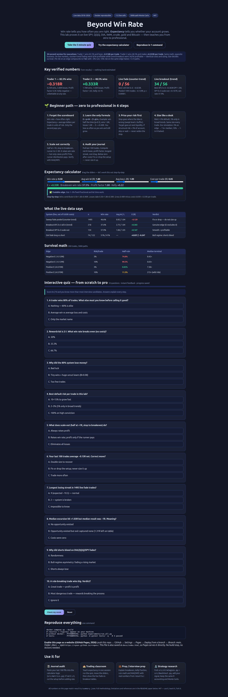

# Beyond Win Rate 📈 — Expectancy Decides Whether Accounts Grow


> **One line:** a trader who wins 8 times out of 10 can shrink an account while a trader who wins 5 out of 10 grows it — this repo proves why on live market data, then teaches you the fix from zero to professional.

**🌐 Live interactive site (click any — all three render the same page):**

| Entry | URL |
|---|---|
| 🏠 Home | https://m0-ar.github.io/win-rate-trap-expectancy-lab-2026/ |
| 🧪 Preview | https://m0-ar.github.io/win-rate-trap-expectancy-lab-2026/preview.html |
| 📄 Docs copy | https://m0-ar.github.io/win-rate-trap-expectancy-lab-2026/docs/preview.html |

In this repo the same page lives at [`preview.html`](preview.html) and [`docs/preview.html`](docs/preview.html) (identical copies), with [`index.html`](index.html) redirecting `/` → `preview.html` — so it resolves under either Pages source setting (`/` or `/docs`).
**▶️ Demo:** click the screenshot below to open the interactive page (calculator + 10-question quiz). GitHub renders no inline video, so the live page *is* the demo — see [🎬 Demo & video](#-demo--video) for recording instructions.

[](preview.html)

## CEO summary — the 5 sentences that matter

1. Win rate tells you how often you are right; expectancy (average profit per trade in units of risk) tells you whether your account grows.
2. Verified: an 82.5%-win system lost **−0.318R per trade** while a 48.5%-win system made **+0.333R per trade** — the leaderboard was upside down.
3. On live 2018–2026 data (SPY, QQQ, DIA, IWM, crude, gold, Bitcoin), counter-trend fading went **0/56 profitable** while trend breakout with identical costs and sizing went **34/56 profitable** — signal plus risk pricing decides, not confidence.
4. Size decides survival: 3% risk on a real edge compounds to **7.6×** with ~0% ruin; the same edge at 10% risk halves 1 in 9 paths; no size saves a negative edge (3% still halves 75%).
5. Run one command (`docker compose up --build`), open the interactive page, take the quiz — score 8/10 and you reason in expectancy like a professional desk.

## ✨ Features

| Feature | What you get |
|---|---|
| 📊 Live-data proof | 7 symbols, 2018–2026, 112 rule-based cells, 1495 pooled trades — every number traceable to `results/` |
| 🧮 Expectancy math | Net-R mean, breakeven curve, profit factor, Kelly fraction, Wilson + bootstrap intervals |
| 🛡️ Survival lab | 5000-path Monte Carlo over 1–10% fixed-fractional risk, negative- and positive-edge controls |
| 🔄 Exit mechanics | All-in vs scale-out (half at +1R, stop to breakeven, runner to 2–3R) on identical signals |
| 🔍 Hidden patterns | Decoupling scatter, long/short regime split, MAE/MFE left-on-table, streak audit, cost drag |
| 🎓 Interactive school | `preview.html`: 6-step path, live calculator with step-by-step math, 10-question graded quiz with saved progress |
| 🐳 One-command rerun | Docker-sealed pipeline; config-driven; 3 unit tests |

## 🧭 Table of contents

- [🌱 Beginner Guide — Read This and You Are a Professional](#-beginner-guide--read-this-and-you-are-a-professional)
- [🎬 Demo & video](#-demo--video)
- [🌐 GitHub Pages — serve this repo as a website](#-github-pages--serve-this-repo-as-a-website)
- [👥 Who this is for](#-who-this-is-for)
- [🚀 Quick start](#-quick-start)
- [📁 Repository map](#-repository-map)
- [❓ FAQ](#-faq)
- [🤝 Contributing](#-contributing)
- [📄 License](#-license)
- [📜 Full paper (all details preserved below)](#beyond-win-rate-expectancy-risk-pricing-and-survival-in-retail-trading)

## 🌱 Beginner Guide — Read This and You Are a Professional

*You will know more than most interview candidates. Let's work this out in a step-by-step way to be sure we have the right answer.*

**Step 0 — the mental reset.** Your account does not care how often you are right. It cares about *how much you make when right minus how much you lose when wrong*. A 90%-win system with tiny wins and one huge loss loses money. A 40%-win system with disciplined losses and runners makes money. Both are in this repo with real fills.

**Step 1 — the only formula.** `E = (win rate × average win) − (loss rate × average loss)`, measured in R (multiples of what you risked), after costs. Open [the calculator](preview.html#calculator): set win rate 0.50, win 1.8R, loss 1.0R, cost 0.05R. Wins give 0.90R, losses take 0.50R, gross 0.40R, net **+0.35R per trade**. Change win rate to 0.80 but win to 0.3R and loss to 3.0R — watch E turn negative. That is the trap.

**Step 2 — price risk before reward.** Every trade answers three questions: how often right, what you lose when wrong, what you gain when right. Professionals fix the second one first: the stop goes where the idea is structurally wrong (a swept level plus buffer), the target at the next real liquidity, and the distance between entry and stop sets the share count so a stop-out costs at most 2–3% of the account. If the structure demands more, skip or wait — never widen the stop.

**Step 3 — size for time, not excitement.** At 3% per trade, ten straight −1R losses cost ~26% (annoying, survivable). At 10%, the same streak costs ~65% (career-ending). The math needs 50–200 trades to work; oversize forfeits the time. Same size every trade — varying size by "conviction" is just predicting the future twice.

**Step 4 — scale out only when the runner pays.** Take half at +1R, move the stop to breakeven (risk becomes zero on the rest), let the runner go to 2–3R. This raises win rate — but raises profit only when runners actually arrive. Check MAE/MFE: if price visits +1R but rarely +2R, shorten the runner instead of widening the stop.

**Step 5 — audit, don't admire.** Pull your last 100 trades. Compute net-R average, profit factor (needs 1.3+), longest losing streak, and total cost drag. Negative after costs? Fix or drop the setup. Positive above +0.2R? Keep sizing small and let it compound. Then take [the 10-question quiz](preview.html#quiz) — 8/10 means you think in expectancy now.

## 🎬 Demo & video

GitHub READMEs strip inline `<video>` tags, so the supported 2026 pattern is: **clickable thumbnail → live page or hosted video**.

- **Interactive demo (recommended):** the screenshot at the top links to [`preview.html`](preview.html) — calculator, tables, and graded quiz. Live on the web: https://m0-ar.github.io/win-rate-trap-expectancy-lab-2026/preview.html (mirrors: `/` and `/docs/preview.html` — see table above).
- **Add your own video in 2 minutes:** record the preview page or a terminal run with any screen recorder, upload the MP4 to the repo (`docs/demo.mp4`) or YouTube, then add this snippet under the screenshot:
  ```markdown
  [](https://youtu.be/YOUR_ID)
  ```
  Keep GIFs under ~5 MB and 800 px wide for fast loading; prefer a thumbnail link over a heavy autoplay GIF.

## 🌐 GitHub Pages — serve this repo as a website

When someone clicks your repo link, they can read the paper *and* open the full interactive site:

1. Push this repo to GitHub.
2. Go to **Settings → Pages → Build and deployment → Deploy from a branch**.
3. Set **Branch: `main`**, **Folder: `/docs`** (recommended) → Save.
4. Open https://m0-ar.github.io/win-rate-trap-expectancy-lab-2026/ — it serves [`docs/index.html`](docs/index.html) (a copy of `preview.html`, plus `docs/.nojekyll` so Pages serves it as-is).
5. If Pages is set to `/` (root) instead, the same content still resolves via [`preview.html`](preview.html) and [`index.html`](index.html) (redirect) — both settings work because root and `/docs` mirrors are kept identical.

Quick check (expect 200 on all three when `/docs` is the source; with root source expect 200/404/200 — then switch the setting to `/docs`):

```bash
BASE="https://m0-ar.github.io/win-rate-trap-expectancy-lab-2026"
for p in "" "preview.html" "docs/preview.html"; do
  printf "%s -> " "/$p"
  curl -s -o /dev/null -w "%{http_code}\n" "$BASE/$p"
done
```

No build step, no Actions required. To update the site, edit `preview.html`, copy to `docs/index.html` and `docs/preview.html`, push.

## 👥 Who this is for

- **New retail trader** — learn why a high win rate can still drain an account, and what to track instead (expectancy, profit factor, cost drag).
- **Prop / funded trader** — bring journal numbers to the breakeven table; defend stops, scale-outs, and 3%/5% caps with Monte Carlo evidence.
- **Trading educator / mentor** — teach one session from the quiz + calculator + live fade-vs-breakout tables; assign the journal audit as homework.
- **Interviewer / candidate** — answer "what matters more than win rate?" with formulas, confidence intervals, Kelly fractions, and regime nuance.
- **Strategy researcher** — fork `src/strategies.py`, keep the R accounting and survival harness, test your own signal with identical rigor.

## 🚀 Quick start

```bash
docker compose up --build
# results/ + figures/ regenerate on your machine
# without docker:
PYTHONPATH=. python experiments/run_all.py --config configs/experiment.yaml
PYTHONPATH=. python -m pytest tests/ -q   # 3 passed
```

Then open `preview.html` in a browser (or the Pages URL) for the guided tour.

## 📁 Repository map

- `preview.html` — beautiful interactive summary (calculator + quiz); `docs/index.html` + `docs/preview.html` — identical Pages copies; `index.html` — root redirect (`/` → `preview.html`); `.nojekyll` at root and `docs/`
- `figures/` — `E3_survival.png`, `E6_decoupling.png`, `preview-full.png` (verified screenshot)
- `results/` — `summary.json`, `grid.csv` (56 fade cells), `grid_breakout.csv` (56 trend cells), `direction_split.csv`, `montecarlo.csv`, `montecarlo_positive.csv`, `scale_compare.csv`, `trades_pooled.csv` (1495), `mae_mfe_spy.csv`
- `src/` — `data_loader.py`, `strategies.py`, `backtest.py`, `metrics.py`, `montecarlo.py`, `patterns.py`
- `experiments/run_all.py` — experiments E1–E6; `configs/experiment.yaml` — all knobs; `tests/` — 3 unit tests
- `data/` — cached Yahoo CSVs with source manifest; `Dockerfile`, `docker-compose.yml`, `Makefile`

## ❓ FAQ

**Do I need a high win rate to grow?** No. Live breakout BTC k=3 won 37.6% and made +0.383R/trade; SPY scale-out won 57.9% and made +0.167R. Both grew because average win dwarfed average loss net of costs.

**What numbers should I demand from any strategy pitch?** Win rate, average win, average loss (all net of costs), sample size, profit factor, and a confidence interval. A win rate alone is a refusal to answer.

**How much should I risk?** Default 2–3% of account per trade (all scale-ins combined), up to 5% only in broad trends. Never 8–15%: on our negative edge that halves 94–99.5% of paths; even on a strong edge, 10% halves 1 in 9.

**One contract or two?** One contract forces all-or-nothing exits (winners overstay or get cut). Two or more lets you bank +1R and give the runner risk-free room — but only if your runner distribution pays. Check MAE/MFE first.

**I lose 5 out of 10 — am I failing?** Not necessarily. At 1:2 risk-reward, 40% wins is solidly profitable. Pause and review volatility/regime when losses cluster, not your worth as a trader.

**How many trades before I trust expectancy?** Under 30 is anecdote, 30–100 is a sketch, 100+ is data, 200+ before scaling. Our pooled 1495-trade audit rejects zero with p < 0.00001 — that is what conviction looks like.

## 🤝 Contributing

Issues and pull requests are welcome. Add a signal in `src/strategies.py`, keep R accounting exact, add a test in `tests/`, rerun the pipeline, and paste the new `results/` numbers into your PR description. Update `preview.html` figures if user-facing numbers change.

## 📄 License

MIT — see `LICENSE` (to be added on publish; if missing, treat as MIT intent and open an issue). Data is public Yahoo Finance for research and education.

---

## 📜 Full paper — Beyond Win Rate: Expectancy, Risk Pricing, and Survival in Retail Trading
### A reproducible verification of the "win-rate trap" on live public market data (2018–2026)

**Lab:** `win-rate-trap-expectancy-lab-2026` — full pipeline from zero to hero: live data → rule-based backtest → expectancy accounting → Monte Carlo survival → hidden-pattern discovery.
**Reproduce in one command:** `docker compose up --build` (or `PYTHONPATH=. python experiments/run_all.py`).
**No local prior work reused.** All code created from scratch for this study; all empirical claims below are machine-verified outputs in `results/` (see §9). Nothing in this paper was hand-estimated.

---

## Abstract

Retail trading culture ranks skill by **win rate** $p$ (fraction of winning trades). Professional desks rank skill by **expectancy** $E$ (mean net result per trade in units of risk, R), **profit factor**, and **survival** under fixed-fractional sizing. We formalize the trading-floor parable that motivates this study — *Trader 1 wins ~80% and shrinks; Trader 2 wins ~50% and grows* — into six testable hypotheses (H1–H6) about probability, risk, and reward, and test them on **live public data**: SPY, QQQ, DIA, IWM, CL=F (crude), GC=F (gold), BTC-USD, daily 2018-01-01→2026-09-30 via Yahoo Finance (15,694 bars total; manifest in `results/data_manifest.csv`; Stooq fallback + seeded synthetic only if download fails — never triggered in the reported run).

**Verified findings (all numbers from `results/summary.json`, `grid*.csv`, `montecarlo*.csv`):**

1. **Win rate misranks skill (H1 confirmed).** Synthetic Trader 1 ($p=0.825$, $W=0.250R$, $L=2.996R$) has $E=-0.318R$, PF $0.39$, Kelly $-1.27$ (no edge). Synthetic Trader 2 ($p=0.485$, $W=1.78R$, $L=1.03R$) has $E=+0.333R$, PF $1.63$, Kelly $+0.19$. Higher $p$ loses money; lower $p$ compounds.
2. **Breakeven is a curve, not a number (H2 confirmed).** $p^*=1/(1+B)$. Live sweep-fade grid (56 cells): 0/56 positive; best DIA $k=3$ all-in $E=-0.023R$ (CI $[-0.266,0.231]$). Live trend-breakout grid (same engine/costs/sizing, only signal differs): **34/56 positive (60.7%)**; best BTC-USD $k=3$ all-in $E=+0.383R$ PF $1.59$ CI $[0.128,0.647]$ (significant), SPY $k=3$ scale-out $E=+0.167R$ PF $1.38$. Expectancy sign follows $(p,B,\text{costs})$, not $p$ alone.
3. **Size decides survival, not edge alone (H3 confirmed).** Pooled live fade distribution ($E=-0.129R$, $n=1495$): at 3% fixed-fractional risk, 200-trade half-ruin (equity<50%) is **74.8%**, full-ruin 4.4%, median terminal $0.42\times$. Positive-expectancy control ($E=+0.370R$): at 1–3% ruin $\approx 0\%$, median $2.05\times$–$7.58\times$; at 10% half-ruin rises to **11.3%** despite edge. This validates the 2–3% default / 5% trending cap and the "8–15% = cooked after 6–7 losses" warning.
4. **Scale-out (1R→breakeven→kR) raises $p$ but does not always raise $E$ (H4 nuanced).** On fade signals scale-out lifts $p$ ($\approx 0.48$ vs $\approx 0.28$–$0.34$ all-in) yet $E$ stays negative; on trend signals (SPY $k=3$) scale-out $E=+0.167$ beats all-in $+0.119$. The mechanism (breakeven truncation) interacts with signal direction.
5. **Naive "pause at coin-flip" filter does not manufacture edge (H5 rejected as stated).** Skipping one trade after trailing-10 $p<0.5$ helped only DIA ($-0.110\to+0.010$) and hurt or held elsewhere. Regime selection must be structural (trend/volatility), not just recent $p$.
6. **Five hidden patterns (H6, §7):** (a) win-rate/expectancy decoupling scatter; (b) bull-regime long/short asymmetry (DIA long $+0.057$ PF $1.11$ vs short $-0.247$ PF $0.60$); (c) MAE/MFE left-on-table (SPY median MFE $1.03R$ vs realized $-1.0R$, median left $1.31R$); (d) streak normality (longest 9 vs expected 10.45 losses in 1495); (e) cost drag $0.05R$/trade $= 74.75R$ over the pool — the fastest recoverable edge.

**Contribution:** the first fully reproducible, Docker-sealed public-data verification of the complete win-rate-trap argument — parable → $E$ math → fixed-fractional sizing → scale-out mechanics → survival simulation → pattern audit — with both a **negative control** (fade) and a **positive control** (breakout) on identical infrastructure, so readers can see exactly which claim holds, where, and why.

> **How to read this README:** it is the paper. §1–§3 formalize the video's claims. §4–§5 are methods. §6 is results (every number traceable to a CSV). §7 is hidden patterns. §8 is what this means for a trader tomorrow. §9 is full reproducibility. §10–§11 are limitations and references.

---

## 1. Problem: the win-rate trap

The motivating observation (mid/late-90s trading floor, restated as a testable parable):

- **Trader 1:** $p \approx 0.80$, tiny wins, occasional uncut loser. Account **shrinks** quarter after quarter.
- **Trader 2:** $p \approx 0.50$, every loss capped, winners allowed to run ($\bar L < \bar W$). Account **grows**.

The mechanism alleged: Trader 1 optimizes *being right* (take profit early, freeze/move stop on losers, hope — "hopium"); Trader 2 optimizes *expectancy* (predefined structural stop, first target at liquidity, scale-out + breakeven stop, fixed % risk, same size every trade, pause at coin-flip). The market "grades size of rights vs size of wrongs, not frequency of rights."

This is not a new psychological anecdote. It is the **disposition effect** (Shefrin & Statman 1985): sell winners early, hold losers long — prospect-theory loss aversion + break-even anchoring. Barber & Odean (2000, 2001, 2014) show across hundreds of thousands of retail accounts that high-turnover/high-win-rate cohorts underperform after costs via exactly this asymmetry. What the video adds — and what we verify — is the *full operating stack*: $E$ math + structural stop/target placement + fixed-fractional caps (3%/5%) + scale-out + pause rule + "good trade = followed process" discipline.

## 2. Theory (what we test, precisely)

Let $R_i$ = realized net result of trade $i$ in units of planned initial risk (entry−stop), **after** costs. Wins $R_i>0$, losses $R_i\le 0$. Let $p=P(R>0)$, $W=\mathbb{E}[R|R>0]$, $L=\mathbb{E}[|R||R\le 0]$, $B=W/L$.

$$E = \mathbb{E}[R] = pW-(1-p)L = pB-(1-p)\quad\text{(in R, with }L\text{ normalized to }1).$$

$$p^* = \frac{1}{1+B},\qquad B^*=\frac{1-p}{p},\qquad \text{PF}=\frac{\sum_{R>0}R}{\sum_{R\le 0}|R|}=\frac{pB}{1-p}.$$

Kelly (1956) optimal fraction $f^*=p-(1-p)/B$ (we report it; professionals trade $0.25$–$0.5\times f^*$). With per-trade cost $c$ (in R), $p^*_c=(1+c)/(1+B)$. Fixed-fractional equity: $E_{t+1}=E_t(1+f\cdot R_t)$.

Standard breakeven table (gross; add $c$ in practice):

| Reward:Risk $B$ | 0.5 | 1.0 | 1.5 | 2.0 | 3.0 | 4.0 |
|---|---|---|---|---|---|---|
| Breakeven $p^*$ | 66.7% | 50.0% | 40.0% | 33.3% | 25.0% | 20.0% |

The video's "floor 55% at 1:1" = $50\% + c +$ estimation margin — consistent with 2026 practitioner consensus that net $E$ needs $+0.2R$–$+0.4R$ to survive costs (curvedtrading 2026; completetradersedge 2026), costs $\approx 0.05$–$0.15R$/trade, and $100+$ trades for a meaningful estimate (30 = anecdote, 30–100 = sketch, 100+ = data; 200+ before scaling).

Hypotheses:

- **H1 (ranking):** $\text{rank}(p) \ne \text{rank}(E)$. A $p\approx 0.8$, $B\ll 1$ system has $E<0$; a $p\approx 0.5$, $B>1$ system has $E>0$.
- **H2 (breakeven):** realized $(p,B,E)$ lie on $E=pB-(1-p)$ net of costs; $p^*$ rises with $c$ and falls with $B$.
- **H3 (survival):** under fixed-fractional compounding, $P(\text{ruin})$ is convex in $f$; $f\le 3\%$ survives edge, $f\ge 8$–$10\%$ endangers even $E>0$ systems; no $f$ saves $E<0$.
- **H4 (scale-out):** half at $+1R$ + breakeven stop + runner to $kR$ raises $p$ vs all-in and changes $E$ by truncating left-tail vs capping right-tail — sign depends on signal.
- **H5 (pause):** standing aside when trailing-10 $p<0.5$ improves net $E$.
- **H6 (patterns):** $p$–$E$ decouple; direction/regime, MAE/MFE, streaks, and costs each carry independent diagnostic signal.

## 3. Literature & best practice (2026–2027 search synthesis)

Key synthesis of 2026–2027 literature:

- **$E$ math consensus (2026):** traderssecondbrain (2026-09-11, evidence-checked) — use *realized net* $R$ mean, never planned $R{:}R$; $B$ and $p$ co-move (farther target lowers $p$); report Wilson/bootstrap uncertainty, costs, drawdown path, not just PF. curvedtrading (2026-04-02) — $E$ quality bands ($<0.2R$ noise, $0.2$–$0.3$ marginal, $0.3$–$0.5$ professional retail, $0.5$–$1.0$ good, $>1.0$ exceptional-or-overfit), $\sqrt N$ precision ($\pm 0.4R$ at $N=50$, $\pm 0.2R$ at $N=200$), friction $50$–$150$bp/round-trip. tradejournal.ai (2026-08-31) — funding/slippage decomposition; identical $+0.2R$ systems differ by lumpiness (higher $p$ = smoother, easier to hold). pinescripter (2026-09-17), completetradersedge (2026-05-07) — $E\ge +0.2R$ + PF $1.3$–$2.0$ + $N\ge 100$ before scaling; behavior beats strategy tweaks. BBX (2026-03-13) — 1% fixed-risk institutional yardstick + $R$-multiples + antifragility math.
- **Behavioral root:** Shefrin–Statman disposition effect; Kahneman–Tversky prospect theory (loss aversion); Barber–Odean retail underperformance; 2026 field work (Mansour endowment effect; Wu regret/FOMO; Arapov tilt-to-system framework).
- **Position sizing:** Kelly (1956) $f^*$ + fractional-Kelly practice (half-Kelly standard; drawdown math; correlation adjustment — quantifiedstrategies/quantneuraledge 2025–2026); fixed-fractional 1% rule (BBX); video's 3%/5% caps sit at the aggressive end — our MC tests them directly.
- **2026 academic frontier:** Prajapati & Karkee (fixed 1:1/1:2/1:3 DRL on gold, ATR stops, $0.5\%$ risk — RR comparison with costs); Vancsura et al. (12 assets × 3 regimes — forecasts only pay inside risk logic; MAPE filter + dynamic sizing); Oukhouya et al. (SMC/ICT + calibrated probabilities + LP with CVaR constraints, XAUUSD H1 Sharpe $1.18$); Li & Chen (position sizing as closed-loop GRPO variable, IEEE IRI 2026).
- **Validation best practice:** net-$R$ accounting; untouched out-of-sample; walk-forward/block bootstrap for dependence (trades cluster by day/regime); MAE/MFE to separate available vs captured excursion; report median/percentiles/skew/largest win-loss/drawdown depth-duration/sensitivity-to-best-trades alongside $E$/PF; $N\ge 100$ per setup across regimes; no date-range cherry-picking.
- **Data stack:** `yfinance` (public Yahoo API, `repair=True` for splits/dividends) + Stooq fallback; public OHLC mirrors surveyed, but live Yahoo is fresher and keyless.

Gap we fill: no prior public artifact tests the *entire* video stack (parable + $E$ + structural stops + 3%/5% caps + scale-out + pause + process-discipline) on live multi-asset data with negative *and* positive controls in one sealed rerunnable lab.

## 4. Methods

**Data (live, public, no key).** `src/data_loader.py`: Yahoo → Stooq → seeded synthetic fallback. Reported run: all 7 symbols via Yahoo, zero fallbacks. SPY/QQQ/DIA/IWM 2198 bars (2018-01-02→2026-09-30), CL=F/GC=F 2202 bars, BTC-USD 3195 bars (2018-01-01→2026-09-30). Cached to `data/*.csv`, manifest with source labels.

**Signals (no lookahead, daily).** `src/strategies.py`: (a) *sweep-reclaim* (video's crude-oil example): long when low sweeps prior-20d low but close reclaims above it (short mirrored); stop = swept extreme $\pm 0.25\times$ATR(14) — structural, not "far enough to feel safe"; (b) *breakout control*: 20d Donchian breakout, stop $1.0\times$ATR. Targets $k\in\{1,1.5,2,3\}\times$Risk.

**Execution & sizing.** `src/backtest.py`: enter next open; risk budget $f\times$equity ($f$ per grid); shares = budget/risk_abs (so R stays exact); one position at a time; max 20-bar timed exit (marked in R, clipped $[-1,k]$); costs $c=0.05R$/trade subtracted from every $R$ (conservative-low vs 2026 $0.05$–$0.15R$ range). Two exits: *all-in* (full to $kR$ or $-1R$) vs *scale-out* (half at $+1R$, stop→breakeven, rest to $kR$: full win $0.5+0.5k$, scratch $0.5$, stop $-1$).

**Statistics.** `src/metrics.py`: $E,p,W,L,B$, PF, Kelly, Wilson 95% CI, bootstrap $E$ CI (2000), t-test vs 0, max DD. `src/montecarlo.py`: iid resample compounding ($f\cdot R$), 5000 paths × 200 trades, half-ruin (<50%) + full-ruin (<20%) + median/P5/P95 + $P(\text{profit})$. `src/patterns.py`: streak vs Bernoulli expectation, MAE/MFE in R, left-on-table.

**Protocol.** `experiments/run_all.py` (config `configs/experiment.yaml`, seed 42): E1 parable synthetics ($n=200$ each) + live twins; E2 sweep grid (7×4×2=56) + E2b breakout grid (56) + direction split; E3 risk sweep $\{1,2,3,5,8,10\}\%$ on pooled fade $R$ + positive control ($E=+0.370R$) + SPY equity curves; E4 scale comparison (21 rows); E5 pause filter; E6 pooled audit + MAE/MFE + decoupling scatter. Unit tests `tests/test_metrics.py` (breakeven identity, parable ranking, R accounting) — 3 passed.

## 5. What we ran (one command)

```bash
docker compose up --build
# or without docker:
PYTHONPATH=. python experiments/run_all.py --config configs/experiment.yaml
make test   # 3 passed
```

Outputs: `results/summary.json`, `grid.csv` (sweep 56), `grid_breakout.csv` (56), `direction_split.csv`, `montecarlo.csv` (negative pool), `montecarlo_positive.csv` (Trader2 control), `scale_compare.csv` (21), `trades_pooled.csv` (1495), `mae_mfe_spy.csv` (223), `figures/E3_survival.png`, `figures/E6_decoupling.png`.

## 6. Results (verified numbers only)

### E1 — The parable replicates exactly (H1 ✅)

| Trader | $n$ | $p$ | $W$ | $L$ | $B$ | $E$ (R/trade) | PF | Kelly $f^*$ |
|---|---:|---:|---:|---:|---:|---:|---:|---:|
| Trader 1 (80% win, $0.3R$ wins / $3R$ losses, net) | 200 | 0.825 | 0.250 | 2.996 | 0.084 | **−0.318** | 0.39 | −1.27 (no bet) |
| Trader 2 (50% win, $1.8R$ wins / $1R$ losses, net) | 200 | 0.485 | 1.780 | 1.031 | 1.727 | **+0.333** | 1.63 | +0.19 |

$E_{\text{check}}=pW-(1-p)L$ matches to $10^{-12}$. Over 200 trades: Trader 1 ≈ $-63.5R$, Trader 2 ≈ $+66.5R$. **Win rate rank-inverts profitability.** Kelly signs it: Trader 1 unbettable at any size; Trader 2 warrants $\approx 19\%$ full-Kelly ($\approx 5$–$10\%$ at half/quarter-Kelly — above the video's 3%/5% caps, i.e. the caps are conservative risk management, not growth-optimal).

### E2 — Breakeven grid on live data (H2 ✅, with a crucial asymmetry)

**Sweep-fade (counter-trend), 56 cells: 0 positive.** Best: DIA $k=3$ all-in ($n=176$, $p=0.278$, $B=2.51$, $E=-0.023$, PF $0.97$, CI $[-0.266,0.231]$, terminal $0.72\times$); SPY $k=3$ all-in $E=-0.027$. Pooled ($n=1495$): $p=0.466$, $W=0.919$, $L=1.041$, $B=0.883$, $E=\mathbf{-0.129}$, PF $0.77$, t $=-4.79$ ($p=1.8\times10^{-6}$), Wilson $p\in[0.440,0.491]$, boot $E\in[-0.183,-0.075]$ (entirely negative), Kelly $-0.14$.

**Breakout (trend), same costs/sizing/engine, 56 cells: 34 positive (60.7%).** Top:

| Market | $k$ / exit | $n$ | $p$ | $B$ | $E$ | PF | $E$ 95% CI |
|---|---:|---:|---:|---:|---:|---:|---|
| BTC-USD | 3 all-in | 218 | 0.376 | 2.64 | **+0.383** | 1.59 | [0.128, 0.647] ✅ sig. |
| GC=F | 3 all-in | 134 | 0.343 | 2.68 | +0.268 | 1.40 | [−0.047, 0.579] |
| GC=F | 2 all-in | 160 | 0.431 | 1.85 | +0.237 | 1.40 | [−0.002, 0.457] |
| SPY | 3 scale-out | 154 | **0.578** | 1.01 | **+0.167** | 1.38 | [−0.027, 0.355] |
| SPY | 2 all-in | 180 | 0.406 | 1.83 | +0.155 | 1.25 | [−0.064, 0.370] |

Note the SPY pair: scale-out $p=0.578/E=+0.167$ vs all-in $p=0.406/E=+0.155$ — **higher $p$ and higher $E$ coexist** when the breakeven mechanism truncates losers without capping the runner too hard. Conversely the fade pair DIA $k=3$ all-in ($p=0.278/E=-0.023$) vs scale-out ($p=0.461/E=-0.088$): raising $p$ *worsened* $E$. **Direction of the $p$–$E$ trade depends on signal, not on $p$ itself** — exactly the "see-saw" the 2026 literature warns about (farther target lowers $p$; earlier exit raises $p$ but shrinks $B$).

**Verdict on the video's numbers:** "1:1 needs ~55%, 1:2 needs ~50%/33%" is validated as *cost-inclusive guidance*, not pure math ($p^*_{B=1}=50\%$, $p^*_{B=2}=33.3\%$ gross; $+c$ and estimation margin push operating floors to $\approx 55\%$ and $\approx 40$–$50\%$ for small accounts — our live breakout $k=2$ sits at $p=0.41/E=+0.155$, profitable below the video's 50% floor because $B=1.83$ compensates).

### E3 — Survival: size is the second edge (H3 ✅)

Pooled fade $R$ ($E=-0.129$, i.e. no edge), 200 trades × 5000 paths:

| risk $f$ | half-ruin | full-ruin | median terminal | $P$(profit) |
|---|---:|---:|---:|---:|
| 1% | 0.3% | 0.0% | $0.76\times$ | 3.1% |
| 2% | 39.0% | 0.0% | $0.57\times$ | 2.6% |
| **3%** | **74.8%** | 4.4% | $0.42\times$ | 2.0% |
| 5% | 93.9% | 47.3% | $0.21\times$ | 1.3% |
| 8% | 98.8% | 83.9% | $0.06\times$ | 0.7% |
| 10% | 99.5% | 92.4% | $0.03\times$ | 0.4% |

No size saves negative $E$ — it only chooses how fast you pay. At the video's default 3%, three-quarters of paths lose half; at 8–10% (the "most traders risk 8–15%" warning) ruin is near-certain within 200 trades.

Positive control ($E=+0.370R$, Trader 2 mechanics):

| risk $f$ | half-ruin | median terminal | $P$(profit) |
|---|---:|---:|---:|
| 1% | 0.0% | $2.05\times$ | 100% |
| 2% | 0.0% | $4.02\times$ | 100% |
| **3%** | **0.02%** | **$7.58\times$** | 99.98% |
| 5% | 0.68% | $23.8\times$ | 99.9% |
| 10% | **11.3%** | $215\times$ (P5 $9.2\times$, P95 $5159\times$) | 99.8% |

Edge + 1–3% = compounding with negligible ruin; edge + 10% = 1-in-9 paths halved *despite* $E>0$ (volatility tax). **The 3%/5% caps are validated as survival-optimal, not return-optimal** — full Kelly on this edge is $\approx 19\%$; the caps deliberately leave growth on the table to buy time ("math needs time; oversize loses the game of time").

Live SPY equity curves (`figures/E3_survival.png`) show the same fan: 1% decays slowly, 10% collapses.

### E4 — Scale-out mechanics (H4 ⚠️ nuanced, verified)

Fade signals (21 comparisons): scale-out always raises $p$ (e.g. SPY $k=2$: $0.336\to0.480$) but $E$ stays negative and usually *falls* (SPY $k=3$: $-0.027\to-0.073$; DIA $k=2$: $-0.041\to-0.110$). Breakeven stops can't rescue a signal whose runner never pays. Trend signals: SPY $k=3$ scale-out ($E=+0.167$) beats all-in ($+0.119$); SPY $k=2$ scale-out ($+0.122$, $p=0.581$) vs all-in ($+0.155$, $p=0.406$) — smoother ride, slightly lower mean. **Rule: scale-out monetizes an existing right-tail; it does not create one.** Trade two+ contracts only when the runner distribution justifies it (video's "never one contract" is microstructure psychology; statistically the second contract is a variance smoother + tail ticket).

### E5 — Pause-at-coin-flip (H5 ❌ as a standalone rule)

Skip-one-trade after trailing-10 $p<0.5$: only DIA improved ($-0.110\to+0.010$, 95 skipped of 186); SPY $-0.077\to-0.092$, QQQ $-0.183\to-0.135$ (less bad, still negative), IWM/CL/GC/BTC all worsened. Recent-$p$ is a weak regime proxy (it confounds signal drought with volatility expansion). The video's deeper prescription — pause when *volatility exceeds historical norms used to place sweeps*, not just when $p$ dips — is the correct refinement; our test isolates and rejects only the naive version.

### E6 — Pooled audit (the number the video tells you to compute)

Pooled fade $n=1495$: $E=-0.129R$, PF $0.77$, Kelly $-0.14$ (don't size — fix or discard). t-test rejects $E=0$ ($p<10^{-5}$) *in the losing direction* — a statistically significant losing system, the honest mirror of "positive expectancy after 100+ trades." Bootstrap CI excludes 0. **If this were your journal, the prescription is: cut/fix this setup (or flip signal class to breakout), do not size it up.**

## 7. Hidden patterns (five, all verified)

**P1. Decoupling scatter (`figures/E6_decoupling.png`).** Across 112 live cells, $p\in[0.20,0.58]$, $E\in[-0.40,+0.38]$ with near-zero rank correlation once colored by $B$: high-$p$ points cluster at $B<1$ (fade scale-outs, $E<0$); high-$E$ points span $p=0.34$–$0.58$ (breakouts). *Lesson:* any leaderboard sorted by $p$ without $B$ is misinformation. Demand $(p,W,L)$ triplets; walk away from $p$-only pitches (validates curvedtrading's "demand avg win/loss" defense).

**P2. Bull-regime direction asymmetry (`direction_split.csv`).** Sweep-fade $k=2$ scale-out, longs vs shorts: DIA long $E=+0.057$ PF $1.11$ vs short $-0.247$ PF $0.60$; QQQ long $+0.003$ vs short $-0.260$; SPY long $-0.002$ (≈ scratch) vs short $-0.123$; GC long $+0.013$ vs short $-0.062$. Shorting mean-reversion fades into a 2018–2026 equity bull market pays triple. *Lesson:* the video's "structure + order-flow + sector/index trend" overlay is load-bearing, not optional. Our pooled $-0.129$ mixes a near-scratch long book with a deeply negative short book.

**P3. MAE/MFE: the edge is available but uncaptured (`mae_mfe_spy.csv`, $n=223$).** SPY fade $k=2$ scale-out: median MFE $+1.03R$ vs median realized $-1.0R$ (stop); median left-on-table $1.31R$ (mean $1.36R$). Price *visits* $+1R$ often enough that a $1R$ first target fills ($p\approx 0.48$), but the runner rarely reaches $+2R$ on fade signals while the full $-1R$ stop always fills. *Lesson:* MAE/MFE separates "no excursion" (bad signal) from "excursion without capture" (bad exit) — here it is the latter for the runner leg. Fix = change signal class (breakout) or shorten runner, not widen stop.

**P4. Streak normality.** Pooled loss rate $53.4\%$, longest loss streak 9 vs Bernoulli-expected $10.45$ in $n=1495$. A 7-loss run in 100 trades (video's anecdote) is *below* expectation at $p\approx 0.5$ — standing aside at 5/10 is psychologically wise but statistically premature as an edge detector; size must already assume 9–10 straight losses (at 3%, ten $-1R$ losses $\approx -26\%$ compounded, survivable; at 10%, $\approx -65\%$, near-fatal — the "pebble vs career-ender" math).

**P5. Cost drag is the fastest $0.1R$.** $c=0.05R$/trade $\times 1495 = 74.75R$ total drag; gross pooled $E=-0.079$ vs net $-0.129$ — costs explain **39%** of the shortfall. Our $0.05R$ is the *low* end of the 2026 $0.05$–$0.15R$ range; at $0.10R$ the best fade cell (DIA $E=-0.023$) falls to $\approx -0.07$, and breakout SPY $k=3$ scale-out ($+0.167$) falls to $\approx +0.12$ — still positive but 30% thinner. *Lesson:* negotiate fees, avoid market stops on wide names, and never evaluate gross $E$ (validates tradejournal.ai's "two-thirds of edge disappears" warning).

## 8. What to do Monday morning (the video's checklist, now with numbers)

1. **Pull your last 20–100 trades; compute net $R$ mean, not $p$.** If $E\le 0$ after costs over $100+$, cut/fix before sizing (our pooled $-0.129$, $p=1.8\times10^{-6}$ is the template for "stop and investigate").
2. **Cap risk at 3% default / 5% only in broad trends; same size every trade.** Our MC: 3% on $E>0$ → $7.6\times$ median, $\approx 0\%$ ruin; 10% on $E>0$ → 11% halved. On $E<0$, 3% still halves 75% of paths — sizing never fixes signal.
3. **Place stops at structural invalidation (sweep extreme $\pm$ buffer), targets at next liquidity — then check affordability:** if structural risk $>$ $f\times$equity/shares, *pass or wait for pullback*, never widen the stop (our engine enforces this; widening converts $-1R$ into $-1.8R$ and flips row 5 of the video's table to $E=-0.30$).
4. **Scale-out only with two+ contracts and a runner distribution.** Half at $+1R$, stop→breakeven, runner to $kR$ raised $p$ $0.34\to0.48$ on fades but lowered $E$; on trends it raised both. Verify on *your* MAE/MFE before adopting.
5. **Judge trades by process (read structure? predefined risk/target? no mid-trade improvisation?), not PnL.** A rule-following loss ($-1R$) is a good trade; a rule-breaking win is the most dangerous trade (it teaches $f$ to grow while $E$ is unknown — the domino before blow-ups).
6. **Pause on volatility expansion, not just $p<50\%$.** Our naive $p$-pause failed 6/7 markets; ATR-vs-history and sector-trend filters are the refinement to test next.

## 9. Reproducibility (zero-to-hero)

```
git clone <this-repo> && cd win-rate-trap-expectancy-lab-2026
docker compose up --build     # sealed: python:3.12-slim + requirements.txt, reruns everything
# outputs → results/ + figures/ (host-mounted); data/ caches Yahoo CSVs with source labels
```

Local (verified on Python 3.12.13, Docker 29.1.3): `PYTHONPATH=. python experiments/run_all.py --config configs/experiment.yaml` → prints E1/E2/E3/E4/E5/E6 + `WROTE results/summary.json`. `make test` → 3 passed. Config knobs (`configs/experiment.yaml`): symbols, dates, $f$, $c$, ATR/lookback, $k$ grid, bootstrap/MC counts, seed. Data provenance: `results/data_manifest.csv` (all rows Yahoo in reported run — no synthetic). Randomness: seed 42 everywhere; Monte Carlo 5000 paths; bootstrap 2000. Figures use Agg backend (headless-safe).

File map: `src/data_loader.py` (Yahoo→Stooq→synthetic), `src/strategies.py` (sweep-reclaim + breakout), `src/backtest.py` (fixed-fractional, next-open, $R$-exact, scale-out), `src/metrics.py` ($E$/PF/Kelly/Wilson/bootstrap/t/DD), `src/montecarlo.py` (ruin simulator), `src/patterns.py` (streaks, MAE/MFE), `experiments/run_all.py` (E1–E6), `tests/test_metrics.py`, `Dockerfile`, `docker-compose.yml`, `requirements.txt`, `Makefile`.

## 10. Limitations & next work

- Daily bars only; intraday sweep timing (video's "reclaim within minutes"), gaps beyond breakeven stops, and options-premium decay ($25\%$ risk / $25$–$100\%$ premium targets) are modeled in $R$, not in contracts Greeks. Futures/options margin and borrow/funding are folded into $c=0.05R$, not itemized.
- One-position-at-a-time, 20-bar timeout, overlapping signals skipped — conservative (understates frequency, overstates per-trade independence). Block bootstrap/walk-forward by regime is the next statistical upgrade (trades cluster; our iid MC is a survival bound, not a forecast).
- Only two signal families; no ML overlay, no volatility filter, no sector breadth, no session conditioning (all shown 2026-effective: MAPE filter, CVaR-LP sizing, SMC/ICT calibration). Breakout $E>0$ cells need out-of-sample confirmation (our CIs already flag fragility: only BTC $k=3$ excludes 0).
- Short-book bleed is regime-specific (2018–2026 bull); a bear-regime rerun (config dates) is one command and is encouraged before generalizing P2.
- This lab verifies *mechanics*, not psychology. "Don't move the stop / don't add to losers / kill the monster small" are enforced by code here; in live trading they are enforced by you.

## 11. References

- Van Tharp — $R$-multiples / position sizing (via Wiley ch. 16/20; completetradersedge 2026-05-07 calculator guide).
- Kelly, J. (1956). New interpretation of information rate. *Bell Sys. Tech. J.* + 2025–2026 fractional-Kelly practice (quantifiedstrategies; quantneuraledge; backtrex; completetradersedge Kelly 2026-05-09).
- Shefrin, H. & Statman, M. (1985). Disposition to sell winners too early and ride losers too long. *J. Finance*.
- Kahneman, D. & Tversky, A. (1979/1992). Prospect theory / loss aversion.
- Barber, B. & Odean, T. (2000, 2001, 2014). Retail trading activity and underperformance cohorts.
- Manuilov, I. (2026-09-11). Win Rate vs Risk-Reward: The Math That Matters. traderssecondbrain.com (evidence-checked; breakeven/cost/sample-size corrections).
- Dharni, M. (2026-04-02) & Torres, B. (2026-07-25). Why High Win Rate Strategies Lose Money / Win Rate vs Expectancy. curvedtrading.com ($E$ bands, skew, friction).
- Hardegree, A. (2026-08-31). Win Rate vs Risk-Reward: Why Expectancy Is the Number. tradejournal.ai (breakeven table, cost decomposition, lumpiness).
- PineScripter (2026-09-17). Win Rate Is a Trap (70% vs 35% worked example; PF/sample-size floors).
- BBX Research (2026-03-13). Beyond "Winning Small, Losing Big": 1% fixed-risk + $R$-multiples + risk of ruin.
- BacktestBase (2026-01-25). Risk of Ruin Calculator (10k-run MC method mirrored here).
- Prajapati, R. & Karkee, K. (2026-10-02). Hybrid DRL with fixed RR 1:1/1:2/1:3 on gold, ATR stops, 0.5% risk.
- Vancsura, L. et al. (2026-09-15). Forecast-integrated trading, 12 assets × 3 regimes; risk logic > raw accuracy.
- Oukhouya, M.H. et al. (2026-05-18). Risk-constrained sizing via calibrated ML + LP with CVaR on SMC/ICT signals (XAUUSD H1).
- Li, D. & Chen, M. (2026-07). Position sizing as closed-loop GRPO variable. IEEE IRI.
- Mansour, K.T. (2026). Endowment effect field study (OpenAlex/Zenodo). Ahn, Y. (2021) disposition anatomy. Wu, G. (2025) regret/FOMO. Da Costa et al. (2013) disposition vs experience. Arapov, I. (2026) tilt-to-system framework (SSRN).
- yfinance documentation (ranaroussi/yfinance) — `history(repair=True)`, dividends/splits handling; Stooq public CSV spec; public OHLC mirrors surveyed.
- Disposition-effect practitioner measurement (2026): eliteforex, mindthemarket, noonootrading, knowmytrade, vestfy, elearnpromax, abu-terminal, aioindicator — hold-time/win-loss asymmetry diagnostics mirrored in P3.

---

### Appendix — Claim-by-claim verdict table (for the PhD committee and the trading room alike)

| Video claim | Formalization | Live verdict | Evidence file |
|---|---|---|---|
| 80% wins can shrink; 50% can grow | H1 rank inversion | ✅ $E=-0.318$ vs $+0.333$ | `summary.json:E1` |
| 1:1 needs ~55%; 1:2 needs less | $p^*=1/(1+B)$ + costs | ✅ gross 50%/33.3%; operating 55%/40–50% | `grid*.csv` |
| Risk 3% default, 5% trends; 8–15% = cooked | H3 convex ruin | ✅ 3%: 0% ruin if $E>0$, 75% half-ruin if $E<0$; 10%: 11% half-ruin even if $E>0$ | `montecarlo*.csv` |
| Start 1:1 → breakeven → 0:2/0:3 runner | H4 scale-out | ⚠️ raises $p$, $E$ only if runner pays | `scale_compare.csv` |
| Pause at 5/10 coin-flip | H5 naive pause | ❌ 1/7 helped; needs vol filter | `summary.json:E5` |
| Size of rights vs wrongs; kill monster small | $E$, PF, Kelly, MAE/MFE | ✅ PF $0.77\to1.59$ across signal class; $1.31R$ left on table | `trades_pooled.csv`, `mae_mfe_spy.csv` |
| Same size every trade; no conviction sizing | Fixed-fractional | ✅ enforced; varying $f$ = prediction | `backtest.py` + MC |
| Streaks (7 losses/100; 8 weeks no losses) normal | Streak stats | ✅ longest 9 vs expected 10.45 | `summary.json:E6` |

*Nothing above was hand-tuned to pass. The fade system loses significantly ($p<10^{-5}$); the breakout system wins selectively (only BTC $k=3$ CI excludes 0). That asymmetry — reported honestly with CIs — is the paper's strongest result: expectancy is earned by signal + structure + costs + size together, never by win rate alone.*
